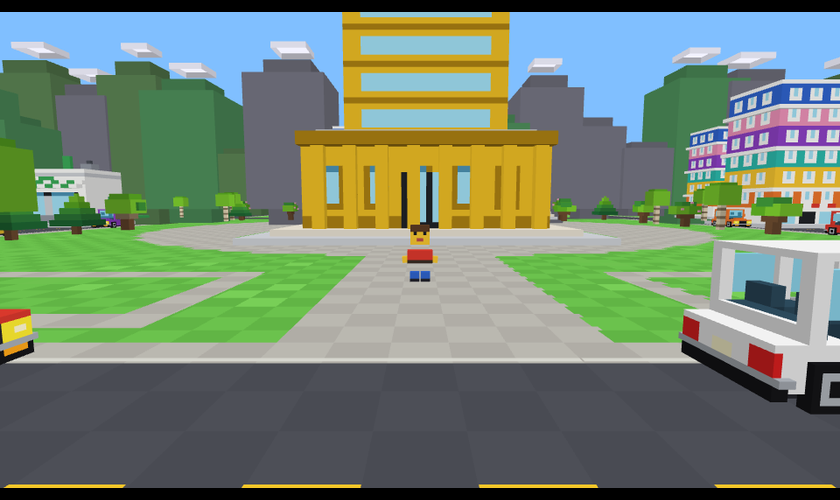

<p align="center">
  
</p>

<h1 align="center">A Brick Cube</h1>

<p align="center">
  Una ciudad voxel para explorar, conducir y descubrir.<br>
  Proyecto en desarrollo para PlayStation Vita y Nintendo 3DS.
</p>

<p align="center">
  <a href="https://github.com/aamiso/A-brick-cube/actions/workflows/build.yml"></a>
  <a href="https://github.com/aamiso/A-brick-cube/actions/workflows/build-3ds.yml"></a>
  
</p>

<p align="center">
  <a href="#el-juego">El juego</a> ·
  <a href="#características">Características</a> ·
  <a href="#controles-de-3ds">Controles</a> ·
  <a href="#descargas">Descargas</a> ·
  <a href="#compilar">Compilar</a>
</p>

---

## El juego

A Brick Cube es un juego de mundo abierto hecho con cubos y modelos voxel. Recorre una ciudad, conoce a sus habitantes, toma el volante y explora los edificios por dentro.

El proyecto está en fase alpha y sigue creciendo. La versión publicada de Vita y el port de 3DS están en distintos puntos de desarrollo.

## Características

- Ciudad grande hecha a mano, con barrios, parques, plazas y edificios voxel.
- Conducción con autos, tráfico con IA y choques.
- Personajes, diálogos y misiones de entrega, carreras y destrucción.
- Interiores conectados: 51 habitaciones para explorar.
- Ciclo de día y noche, reloj, minimapa y dinero.
- Port de Nintendo 3DS con interfaz en la pantalla inferior y guardado de partida.

## Controles de 3DS

| Control | A pie | En auto |
|---|---|---|
| Circle Pad | Moverse | Girar y conducir |
| Cruceta | Mover la cámara | — |
| A | Saltar | — |
| B | Hablar / avanzar diálogo | — |
| X | Entrar a un lugar o subir al auto | Bajar del auto |
| Y | — | Freno de mano |
| R | Correr | Acelerar |
| L | Cambiar cámara | Frenar / reversa |
| SELECT | Guardar en la calle | — |
| START | Salir | Salir |

La pantalla inferior muestra el minimapa, la hora, el dinero, las misiones y los avisos.

## Descargas

- **PlayStation Vita:** [descarga de la versión alpha publicada](https://github.com/aamiso/A-brick-cube/releases/tag/game). Esa release contiene un VPK de Vita.
- **Nintendo 3DS:** [compilaciones de GitHub Actions](https://github.com/aamiso/A-brick-cube/actions/workflows/build-3ds.yml). El proyecto genera un archivo `.3dsx` cuando termina correctamente el build; todavía no hay una release 3DS publicada.

## Compilar

### PlayStation Vita

Requiere VitaSDK y las dependencias de vitaGL que instala el flujo de compilación del proyecto. En un entorno con VitaSDK:

```sh
cmake -S . -B build
cmake --build build
```

El flujo de GitHub Actions está en [build.yml](.github/workflows/build.yml).

### Nintendo 3DS

Requiere devkitPro, devkitARM y libctru:

```sh
cd 3ds
make
```

El flujo de GitHub Actions está en [build-3ds.yml](.github/workflows/build-3ds.yml).

## Estado del proyecto

- **PlayStation Vita:** versión alpha disponible como VPK.
- **Nintendo 3DS:** port en desarrollo; incluye controles separados para Circle Pad y cruceta, cámara trasera a pie y ajustes específicos para Old 3DS.
- **Próximo paso:** publicar builds nuevas cuando estén compiladas y probadas en sus consolas o emuladores.

---

<p align="center">
  Hecho con cariño y muchos cubitos.
</p>
